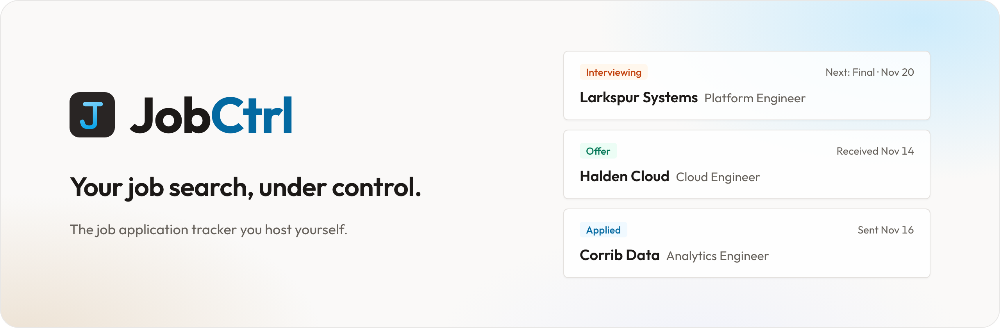
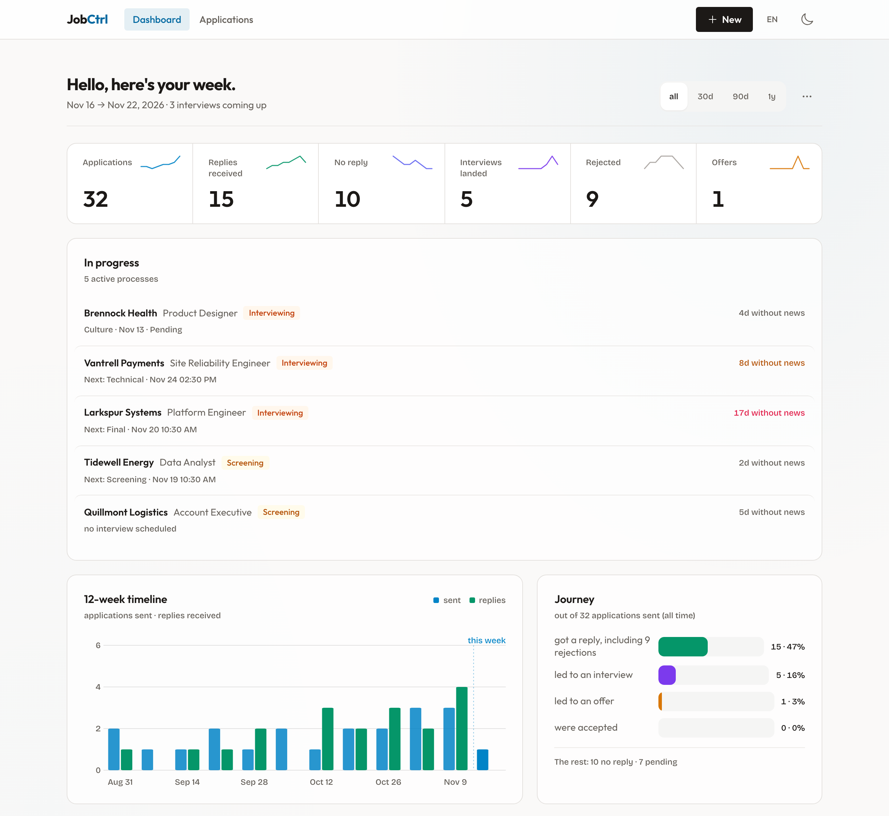

<div align="center">

<picture>
  <source media="(prefers-color-scheme: dark)" srcset=".github/assets/banner-dark.png">
  
</picture>

[Install](#install) · [Configuration](#configuration) · [Upgrading](#upgrading) · [Changelog](CHANGELOG.md)

</div>

## What is JobCtrl?

JobCtrl keeps your job search in one place: every application, where it stands, what comes next and who has not answered yet. It runs on your own machine as one binary and one SQLite file, with no account to create.

## Features

- **See where you stand.** A dashboard by period with clickable indicators, an "In progress" card for live processes and their next interview, a 12-week timeline of applications sent and replies received, a six-month activity heatmap, a journey funnel and a full status breakdown.
- **Follow every application.** Statuses from Wishlist to Accepted, with interviews, contacts, notes and a dated history.
- **Add a job in one paste.** Paste the link of a job listing and the company, title and salary are filled in from the page.
- **Nothing slips through.** A reminder shows up when a process has gone quiet for ten days after an interview, and you can snooze it. Applications left unanswered for 30 days move to "No reply" on their own.
- **Lists your way.** Table or Kanban, search, filters, sorting by date, company, status, confidence or interest, bulk status changes, and a warning before you apply twice to the same company.
- **Your data stays yours.** JSON backup and restore, CSV export for spreadsheets, and a snapshot of the database before any upgrade that changes its schema.
- **French and English**, light and dark themes, and a layout that works on a phone too.

## Screenshots

<picture>
  <source media="(prefers-color-scheme: dark)" srcset=".github/assets/dashboard-dark.png">
  
</picture>

<p align="center"><sub>The dashboard, filled with made-up applications.</sub></p>

## Install

### Docker (recommended)

```bash
mkdir jobctrl && cd jobctrl
curl -O https://raw.githubusercontent.com/karl-cta/jobctrl/main/docker-compose.yml
docker compose up -d
```

Open [http://localhost:8080](http://localhost:8080). Your data lives in a Docker volume. Images are published for `linux/amd64` and `linux/arm64`.

### From source

Requires Go 1.26+ and Node.js 22+.

```bash
git clone https://github.com/karl-cta/jobctrl.git
cd jobctrl
make install   # frontend deps
make build     # frontend + Go binary
./job-ctrl     # starts on :8080
```

## Configuration

| Variable | Default | Description |
|----------|---------|-------------|
| `JOB_CTRL_DB_PATH` | `job-ctrl.db` | SQLite database path |
| `JOB_CTRL_ADDR` | `:8080` | Listen address |
| `JOB_CTRL_NO_REPLY_DAYS` | `30` | Days before an unanswered application becomes "No reply" (`0` disables) |

JobCtrl has no built-in authentication. Keep it on your machine or local network, and do not expose it to the internet without a reverse proxy that adds authentication. The proxy must forward the original `Host` header, port included (nginx: `proxy_set_header Host $http_host;`), otherwise saving changes is rejected as a cross-origin request.

## Upgrading

Your data lives in a single SQLite file and every upgrade is designed to keep it intact:

- **Automatic backup.** Before a schema migration runs on an existing database, the app writes a consistent snapshot next to it (`job-ctrl.db.backup-<timestamp>`) and logs its path. Keep or delete these files as you like.
- **Migrations are additive.** Your history is kept. The only rows ever removed are interviews, contacts and timeline entries that still belonged to applications you had deleted: older versions kept them by mistake, and 1.2.0 cleans them up once. The only status ever removed, "Withdrawn" (1.1.0), is mapped back to "Applied" with a visible entry in each affected application's timeline. Applications left unanswered for more than 30 days then move to "No reply" on their own (see `JOB_CTRL_NO_REPLY_DAYS`).
- **Old exports still import.** A JSON backup made with a previous version restores cleanly: legacy statuses are mapped, and interviews that older versions silently dropped ("Screening" type, "Rejected" outcome) are now kept. Anything the importer cannot take is logged rather than lost.

While the app runs, SQLite keeps two companion files next to the database, `job-ctrl.db-wal` and `job-ctrl.db-shm`. To roll back an upgrade, stop the app, delete `job-ctrl.db-wal` and `job-ctrl.db-shm`, then copy the backup file over `job-ctrl.db`. With Docker, the files live in the volume (`docker volume ls` shows its name):

```bash
docker compose down
docker run --rm -v <volume>:/data alpine sh -c \
  'rm -f /data/job-ctrl.db-wal /data/job-ctrl.db-shm && cp /data/job-ctrl.db.backup-<timestamp> /data/job-ctrl.db'
```

Then pin the previous image tag in `docker-compose.yml` before starting again, or the new version will migrate the database once more.

## Development

```bash
make dev                         # Go + Vite hot reload
go test ./...                    # backend tests
cd frontend && npm run build     # type-check and build the frontend
```

## Stack

Go and [chi](https://github.com/go-chi/chi), SQLite in pure Go (no CGO), vanilla TypeScript with Vite and Tailwind, Docker.

## License

[MIT](LICENSE)
